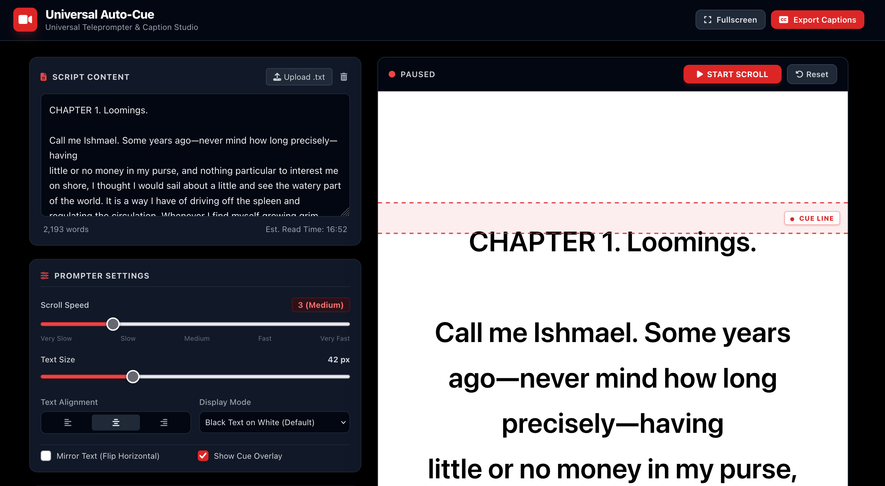
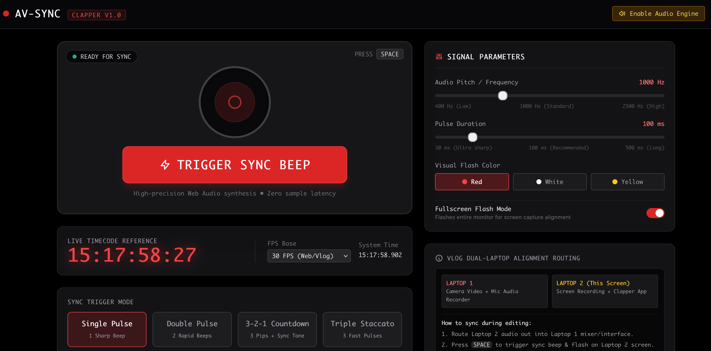

# vutilities

This repo hosts a few useful little web utilities designed for vlogging. All utilities run as a single webpage, with one function.  

## Universal Auto-Cue

[Universal Auto-Cue](https://autocue.mark-reuter.workers.dev/)

This is an auto-cue 'scrolling text' app. Use it whenever you need to read a script, news report, weather, story, and whatever. It supports .txt file upload, and can generate YouTube captions from the script. The text size and scroll speed can be controlled

## Clapper
Clapper is designed to sync audio/video streams when using >1 laptop to record content. e.g.  laptop 1 might be recording video and sound, while laptop 2 is a screen recording (OBS etc). The page generates both audio and visual cues that can be used to align files in a video editor. 

## Image Cycler
Image Cycler plays all the png/jpg images in a folder, specified by the user. I user can change the duration of each image, and switch to full screen view. This is useful for showing background or illustrative images while narrating content (or use it as an in-browser photo frame). 

Please report bugs [bugs](mailto:mark.reuter@googlemail.com)
